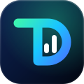

<p align="center"></p>

# TabDin

Gestão financeira pessoal com **Open Finance Brasil**, o assistente de IA **Din**, dashboards e um **cofre de senhas zero‑knowledge** para logins e cartões. Interface azul-marinho com acento esmeralda, inspirada no iOS e instalável no celular (PWA).

    

## Funcionalidades

| Módulo | O que faz |
|---|---|
| **Autenticação** | Cadastro e login com e-mail e senha (Supabase Auth). Cada usuário tem sua própria senha e enxerga só os próprios dados. |
| **Din (assistente IA)** | Chat em linguagem natural sobre suas finanças: "quanto gastei com iFood?", "compare com o mês passado", "quais assinaturas eu pago?". Usa Claude com ferramentas de leitura sobre os dados do próprio usuário (RLS). Sem chave de API, roda em modo básico com respostas por intenção. |
| **Dashboard** | Saldo consolidado, variação vs. mês anterior, fluxo de caixa de 6 meses, gastos por categoria, orçamentos e **assinaturas detectadas automaticamente**. |
| **Transações** | Lançamentos manuais, filtro por mês, tipo e busca, recategorização inline. |
| **Contas** | Contas corrente, poupança, cartão, investimento e carteira; o saldo das contas manuais é atualizado por trigger no banco. |
| **Open Finance** | Conexão com bancos reais via [Pluggy](https://pluggy.ai) (widget oficial), importação de contas e transações com categorização automática. Um **Banco Demo** gera dados simulados para quem quiser testar sem conectar nada. |
| **Cofre** | Gerenciador de senhas (logins) e cartões, cifrado no navegador com a senha mestra do usuário. Tem gerador de senhas, medidor de força, cópia com limpeza da área de transferência e bloqueio automático. |

## Arquitetura de segurança

### Isolamento por usuário (Row Level Security)
Todas as tabelas têm RLS habilitado com políticas `auth.uid() = user_id` para `select/insert/update/delete`. Mesmo usando a chave pública no navegador, um usuário não consegue ler nem gravar dados de outro. Isso foi verificado com um teste SQL que simula dois usuários.

### Cofre zero‑knowledge
```
senha mestra ──PBKDF2-SHA256 (600k iterações, salt por usuário)──▶ chave AES-256-GCM (não exportável, só na memória)
item {título, usuário, senha, ...} ──AES-GCM + IV aleatório──▶ { ciphertext, iv } ──▶ Supabase
```
- A senha mestra **nunca** sai do dispositivo, e o servidor guarda apenas `salt` + um verificador cifrado.
- Sem a senha mestra, nem o administrador do banco consegue ler os itens.
- A chave é descartada ao bloquear, após 5 minutos de inatividade ou ao recarregar a página.

### Open Finance
- As credenciais da Pluggy (`CLIENT_SECRET`) ficam apenas no servidor (rotas `/api/open-finance/*`).
- O connect token é emitido com `clientUserId = id do usuário`, e a sincronização recusa itens de outro usuário.
- O acesso aos dados bancários é somente leitura e acontece via consentimento no ambiente do próprio banco.

## Stack

- **Next.js 16** (App Router, Server Actions, Cache Components / Partial Prerendering, `proxy.ts`)
- **Supabase**: Postgres, Auth, RLS e triggers (`@supabase/ssr` para sessão via cookies)
- **Tailwind CSS v4** com design system próprio (vidro fosco, SF Pro, cantos de 22px)
- **Claude API** (`@anthropic-ai/sdk`, Tool Runner) para o assistente Din
- **PWA**: manifesto, ícones e áreas seguras do iPhone; instalável na tela inicial
- **Recharts** para gráficos, **Zod** para validação e **lucide-react** para ícones
- **Web Crypto API** para a criptografia do cofre

## Estrutura

```
src/
├── app/
│   ├── (auth)/           login, cadastro e server actions de autenticação
│   ├── (app)/            área logada: dashboard, transacoes, contas, open-finance, cofre
│   ├── api/open-finance/ connect-token e sync (Pluggy / Banco Demo)
│   └── auth/confirm/     callback de confirmação de e-mail
├── components/           Nav (sidebar + tab bar iOS), Sheet, ícones
├── lib/
│   ├── crypto/vault.ts   PBKDF2 + AES-GCM, gerador de senhas
│   ├── openfinance.ts    cliente Pluggy, normalização e persistência
│   └── supabase/         clientes browser/server e renovação de sessão
└── proxy.ts              protege rotas e renova a sessão
supabase/migrations/      schema completo (tabelas, RLS, triggers)
```

## Rodando localmente

```bash
git clone https://github.com/<seu-usuario>/tabdin.git
cd tabdin
npm install
cp .env.example .env.local   # preencha com as chaves do seu projeto Supabase
npm run dev
```

1. Crie um projeto em [supabase.com](https://supabase.com) e rode `supabase/migrations/20261117000000_init_schema.sql` no SQL Editor.
2. Em **Authentication → URL Configuration**, adicione `http://localhost:3000/auth/confirm` às Redirect URLs.
3. *(Opcional)* Preencha `ANTHROPIC_API_KEY` ([console.anthropic.com](https://console.anthropic.com)) para ativar o Din com IA.
4. *(Opcional)* Crie uma conta sandbox gratuita em [dashboard.pluggy.ai](https://dashboard.pluggy.ai) e preencha `PLUGGY_CLIENT_ID` e `PLUGGY_CLIENT_SECRET`. Sem elas, o app oferece o **Banco Demo**.

## No celular

- **Na mesma rede Wi‑Fi:** rode `npm run dev:mobile` e abra `http://IP-DO-PC:3000` no celular.
- **Instalar como app:** depois do deploy (HTTPS), abra o site no Safari ou Chrome e toque em **Compartilhar → Adicionar à Tela de Início**.

## Deploy (Vercel)

Importe o repositório na Vercel, configure as mesmas variáveis de ambiente e adicione `https://SEU-DOMINIO/auth/confirm` às Redirect URLs do Supabase.

## Licença

MIT
